# 歷年活動資訊

發布日期：2024-03-23  
分類：活動與研討會

<!-- ARTICLE CONTENT -->

## 更新至2023年09月

2023/09/08「優勢觀點與社會工作」實務研討會

* 主題：**優勢觀點在社工實務的扎根與成長經驗：督導、團體與華人文化的薈萃**
* 本次研討會主要聚焦在學術界和實務界之非營利組織運用優勢觀點的經驗以及督導的方法，透過實務文章發表，相互交流與分享，讓各領域的實務工作者能夠借由他山之石，更加瞭解現今優勢觀點運用於組織管理和社工督導的精神和實施方式，進而交互激盪出更多元的工作方法和技巧，累積更厚實的實務工作能量。研討會中這些寶貴經驗也能夠回饋於學術領域，透過整理、分析與歸納，累積更多的實證基礎，做為未來社會工作實務、教育與研究發展之依據。

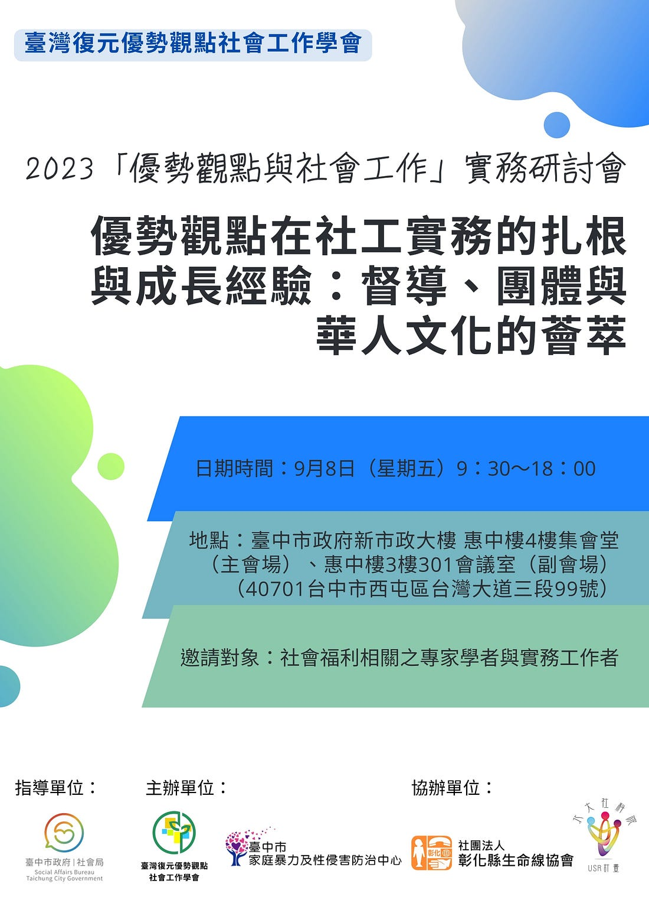
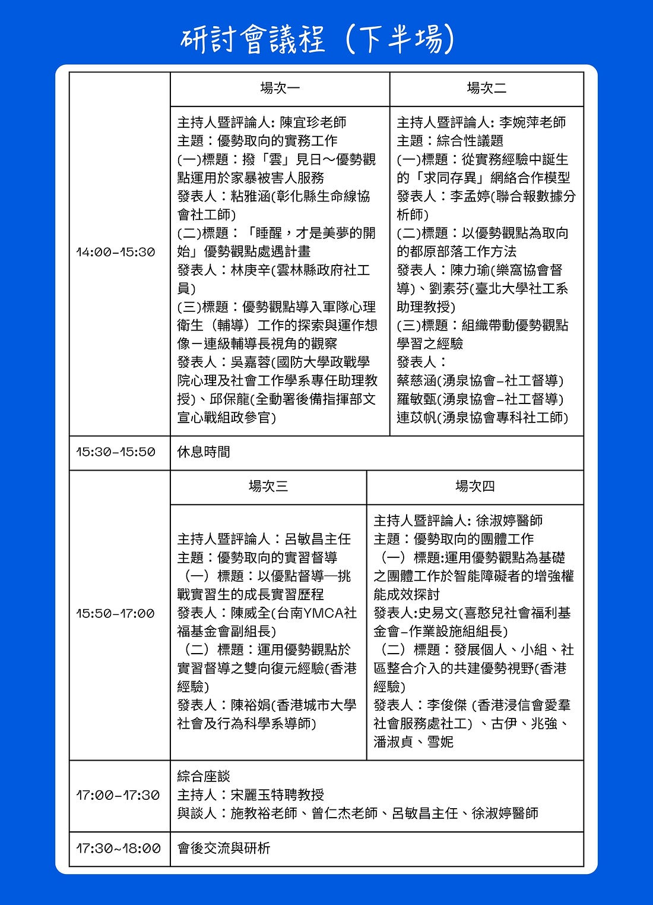
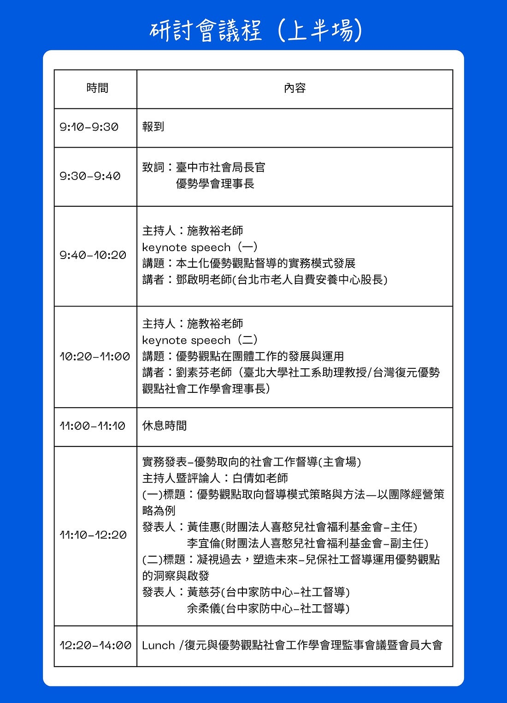

新書出版優勢觀點與社會工作實務－邁向復元之路

* 本書是「臺灣復元優勢觀點社會工作學會」和「香港復元與優勢觀點社會工作協會」成員共同合作的結晶。……過去十五年來，優勢觀點獲得港臺社會工作界的重視，在許多領域運用且開花結果；本人於2016年發想編輯此書，希望記錄我們走過的軌跡，留下豐碩的成果，並提供不同領域的專業人員參考。 — — 宋麗玉
* 作者：白倩如、宋麗玉、江羿潔、李婉萍、吳慧菁、余佳臻、林月英、周倩儀、施教裕、洪珮容、梁少玲、郭貴蘭、陳裕娟、陳國溪、張憶純、張錦麗、黃尹中、曾仁杰、曾月娥、黃美群、黃游麗、葉明岱、楊隆威、楊曉林、劉素芬
* 主編：社團法人台灣復元優勢觀點社會工作學會、宋麗玉
* 出版日期：2018/07/16
* [詳情請點擊連結](http://www.books.com.tw/products/0010793609)：

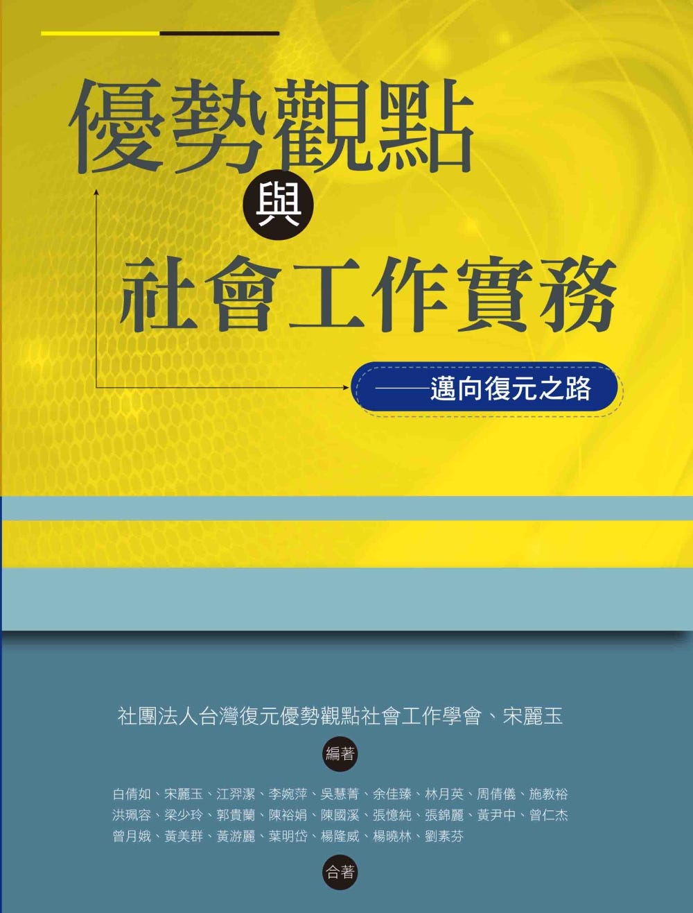

2022/08/10 優勢觀點督導認證申請資格及辦法

* 一、 申請資格：需具備社會工作實務相關經驗五年以上且實際運用優勢觀點三年以上之條件。
* 二、 申請認證條件：

1. 督導年資達兩年以上。
2. 操作優勢觀點個案工作至少五個以上、或帶領以優勢觀點為基礎之團體工作達兩年以上。
3. 公開發表優勢觀點案例至少一次。
4. 經理事或監事推薦之人選。
5. (前三項為必要條件，須至少符合一項)

* 三、 督導認證更新制度：每三年由優點督導檢附以下任一項證明，持續授予證書 。

1. 參與優勢觀點相關研討會。
2. 撰寫或發表優勢觀點相關文章。
3. 教授優勢觀點相關課程。
4. 出版優勢觀點相關書籍。

* 四、 符合以上資格者，請將申請表及相關證明文件掃描或拍照後email至strengths.tw@gmail.com ，並待理監事會審核與通知。
* 請點擊下載[優勢觀點督導認證申請資格及辦法 20220730修(上網版)](http://socialwork2009.nccu.edu.tw/crsp/a/%E5%84%AA%E5%8B%A2%E8%A7%80%E9%BB%9E%E7%9D%A3%E5%B0%8E%E8%AA%8D%E8%AD%89%E7%94%B3%E8%AB%8B%E8%B3%87%E6%A0%BC%E5%8F%8A%E8%BE%A6%E6%B3%95%2020220730%E4%BF%AE(%E4%B8%8A%E7%B6%B2%E7%89%88).docx) (2022.07.30更新)

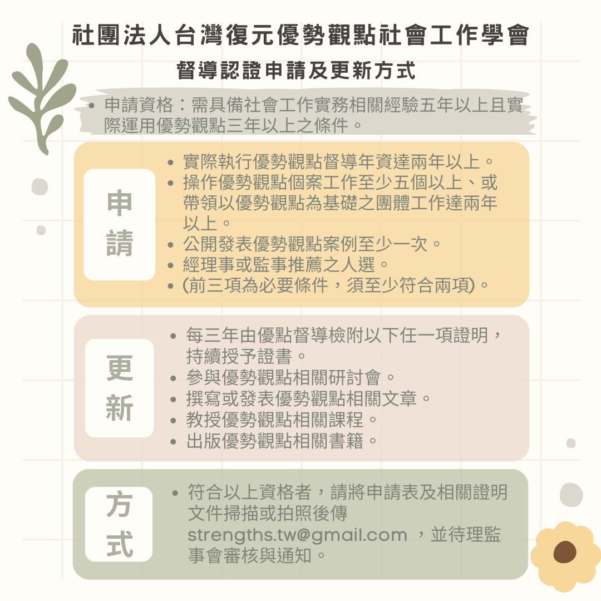

2021/11/28 第四屆第一次理監事、會員大會會議紀錄

* 第四屆第一次理監事選舉結果

1. 常務理事當選人：劉素芬、李婉萍、陳宜珍
2. 理事長當選人：劉素芬
3. 副理事長當選人：李婉萍
4. 常務監事當選人：葉明岱

* 第四屆第一次會員大會紀錄

1. 110、111年度工作報告、決算書表1案，提請討論。
2. 任命陳介中擔任秘書長。
3. 選舉理監事。

* 請點擊下載[理監事會議紀錄](http://socialwork2009.nccu.edu.tw/crsp/a/20220122_%E7%AC%AC%E5%9B%9B%E5%B1%86%E7%AC%AC%E4%B8%80%E6%AC%A1%E7%90%86%E7%9B%A3%E4%BA%8B%E6%9C%83%E8%AD%B0%E7%B4%80%E9%8C%84(%E5%AE%8C%E6%95%B4%E7%89%88).pdf)、[會員大會紀錄](http://socialwork2009.nccu.edu.tw/crsp/a/20220122%E7%AC%AC%E5%9B%9B%E5%B1%86%E7%AC%AC%E4%B8%80%E6%AC%A1%E6%9C%83%E5%93%A1%E5%A4%A7%E6%9C%83%E7%B4%80%E9%8C%84(%E5%AE%8C%E6%95%B4%E7%89%88).pdf) (2022.1.24更新)

2017/05/01 2017優勢觀點港臺國際研討會

* 請點擊下[載2017優勢觀點臺港國際研討會手冊](http://socialwork2009.nccu.edu.tw/crsp/a/2017%E5%84%AA%E5%8B%A2%E8%A7%80%E9%BB%9E%E8%87%BA%E6%B8%AF%E5%9C%8B%E9%9A%9B%E7%A0%94%E8%A8%8E%E6%9C%83%E6%89%8B%E5%86%8A(%E5%85%A8).pdf)(全) (2017.5.9更新)

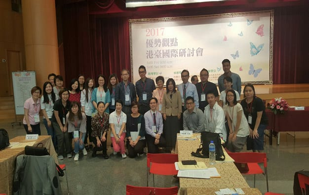

2017/03/21 2017優勢觀點港臺國際研討會

* 復元與優勢觀點自2003年10月在台灣推動，至今已邁入第13年，由宋麗玉教授與台灣的學者和實務工作者形成團隊持續倡導，旨在提升社會工作實務之理論基礎，以增進服務品質和社會工作人員專業知能。此模式在台灣實施的領域含括家庭暴力被害人與相對人、高風險家庭、新移民家庭、弱勢家庭、身心障礙者、弱勢青少年、犯罪青少年等等，已累積相當多的研究與實務成果。
* 本次研討會將邀請香港實務界共襄盛舉，促進雙方進一步交流。藉此促進國內外學術界於優點模式處遇之互動與對話，激發更多的相關論述、促進台灣學術研究與實務發展之國際化，期能讓國內社會工作界對於優點模式處遇模式有更深刻的認識及運用。
* 指導單位：新北市政府社會局  
  承辦單位：社團法人新北市湧泉社會服務協會、社團法人台灣復元優勢觀點社會工作學會  
  協辦單位：社團法人桃園縣拾穗關懷服務協會、映晟社會工作師事務所
* 報名方式：**填寫網路報名表單**<https://goo.gl/AKCp35>  
  **收到回覆信件後為確認完成報名。(恕不接受傳真或電話報名)**

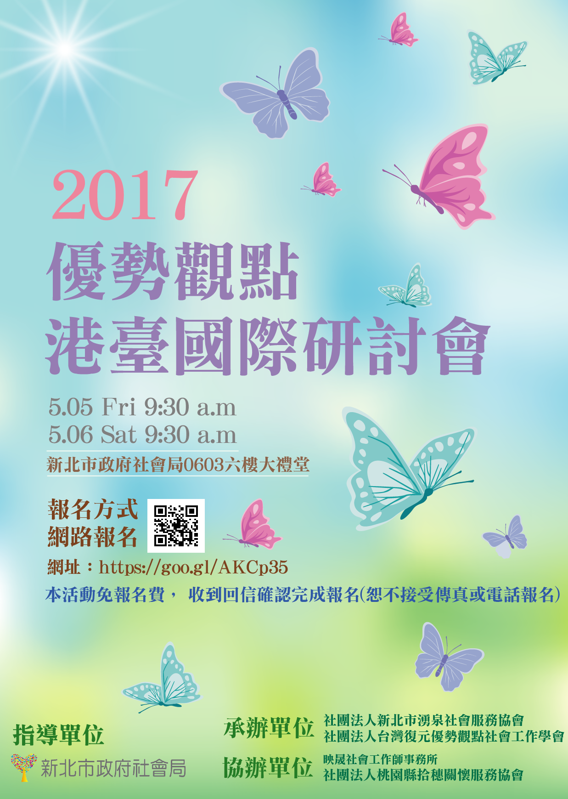

2016/07/06 、07/07 前往香港Harmony House、Christian Family Service Centre、Caritas Family Crisis Support Centre參訪

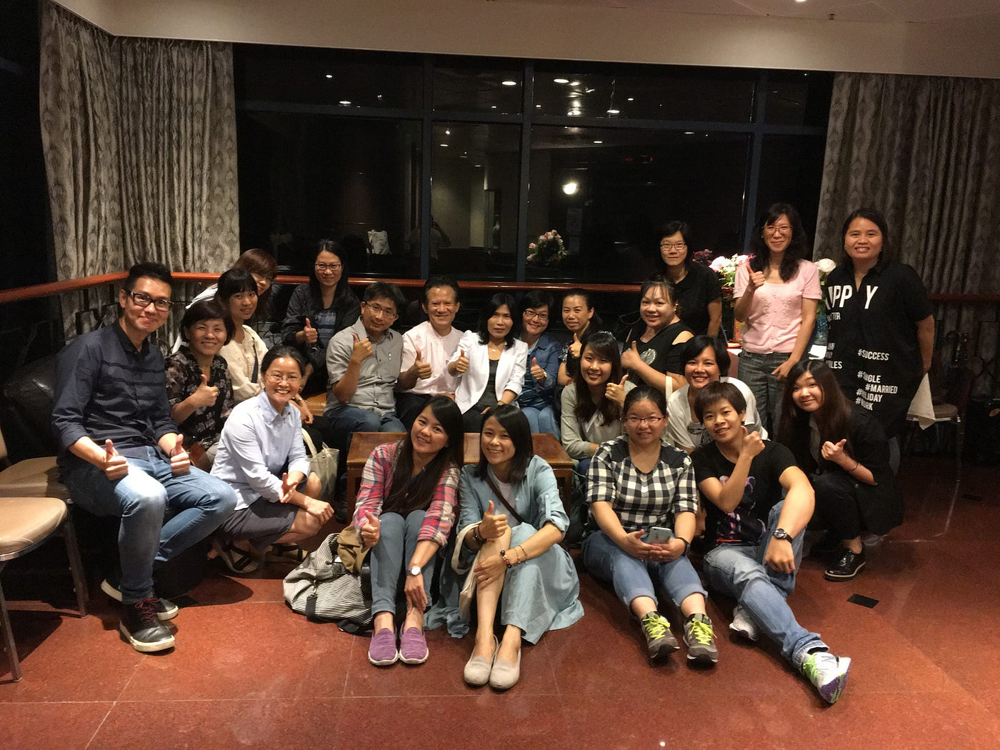
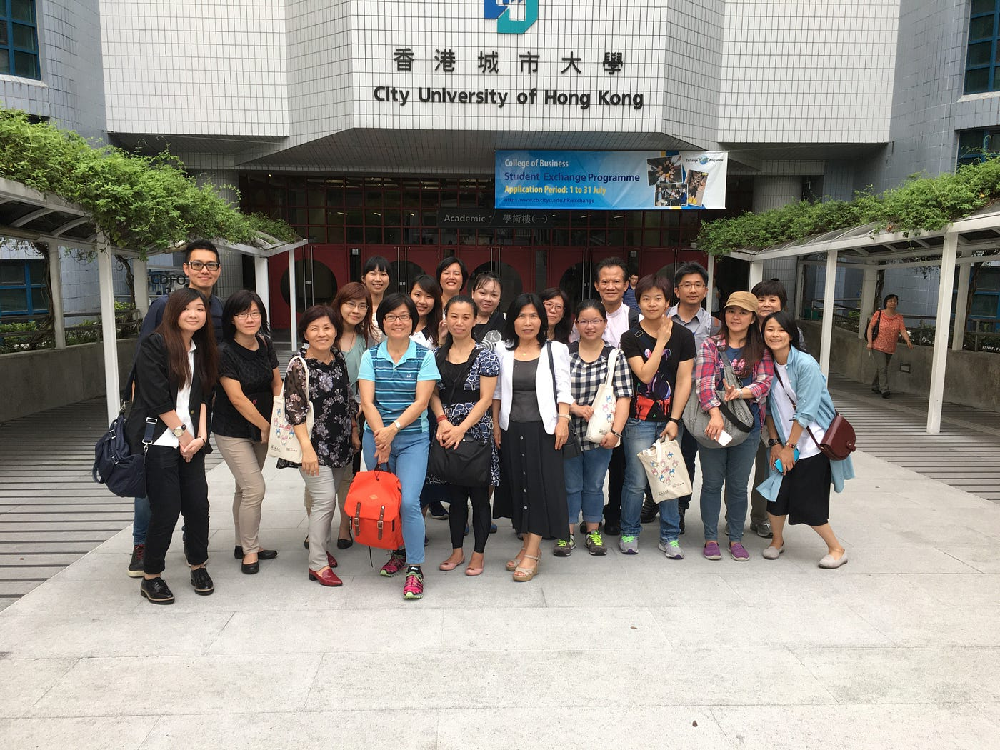

2016/06/01 「優游自在，展現生命韌性」2016優勢觀點研討會

* [研討會手冊2016優點研討會手冊全文](http://socialwork2009.nccu.edu.tw/crsp/a/2016%E5%84%AA%E9%BB%9E%E7%A0%94%E8%A8%8E%E6%9C%83%E6%89%8B%E5%86%8A%E5%85%A8%E6%96%87.pdf)
* 會議記錄紀錄

2015/08/28 邁向復元之路-服務使用者與提供者之對話實務研討會資訊

* 優點學會與台灣群力全能發展學會預計在104年8月28日於高雄市政府社會局鳳山婦幼青少年活動中心舉辦的【邁向復元之路-服務使用者與提供者之對話實務研討會】，歡迎各位踴躍參與。
* 本研討會目的在於提供交流平台，讓復元與優勢觀點之使用經驗，得以在服務提供者和服務使用者之間進行交流，精彩可期。

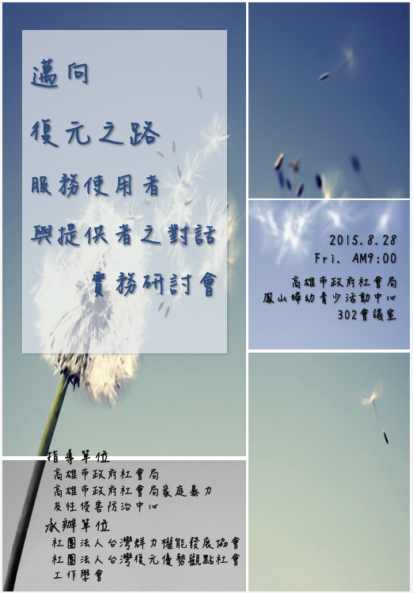

2014/06/26、06/27 優勢觀點與家庭處遇國際研討會論文

* 於103年6月26、27日在政大所舉辦的優勢觀點與家庭處遇國際研討會已圓滿結束，感謝各位熱烈的參與。
* 研討會累積了相當豐富的實務案例和研究論文，經作者授權及主辦單位集結整理後，現在與各界學者及實務工作者分享，以促進彼此的交流互動，期待激發更多的相關論述。

2014/06/26、06/27 優勢觀點與家庭處遇國際研討會

* 復元與優勢觀點自2003年十月在台灣推動，至今已邁入第十一年，由政治大學社工所宋麗玉教授連同台灣的學者和實務工作工作者形成團隊持續倡導和協助，旨在提升社會工作實務之理論基礎，以增進服務品質和社會工作人員專業自信。此模式在台灣開始於婚暴領域推動落實優勢觀點個案管理模式，至今實施的領域含括婚姻暴力被害人與相對人、高風險家庭、新移民家庭、弱勢家庭、身心障礙者、弱勢青少年、犯罪青少年，亦累積相當之研究與實務成果，這些運用都涉及家庭，而家庭向來為社會工作主要的工作範疇之一。
* 此次國際研討會將邀請美國、澳洲、新加坡和香港五位學者，以及香港實務界共襄盛舉，促進雙方進一步交流。藉此促進國內外學術界於優點模式和家庭處遇之交流互動與對話，激發更多的相關論述、促進台灣學術之國際化，也讓國內社會工作界對於優點模式和家庭處遇模式之深刻認識及運用。
* 主辦單位：社團法人臺灣復元優勢觀點社會工作協會、國立政治大學社會工作研究所 /協辦單位：衛生福利部、科技部、國立政治大學  
  報名方式：報名方式請參  
  <http://socialwork.nccu.edu.tw/app/news.php?Sn=811> 。
* 本研討會名額有限，歡迎有興趣者盡快報名，以免向隅。
* 請於登記報名後七日內，至郵局劃撥繳費始完成報名手續，大會將以電子郵件通知報名確認。

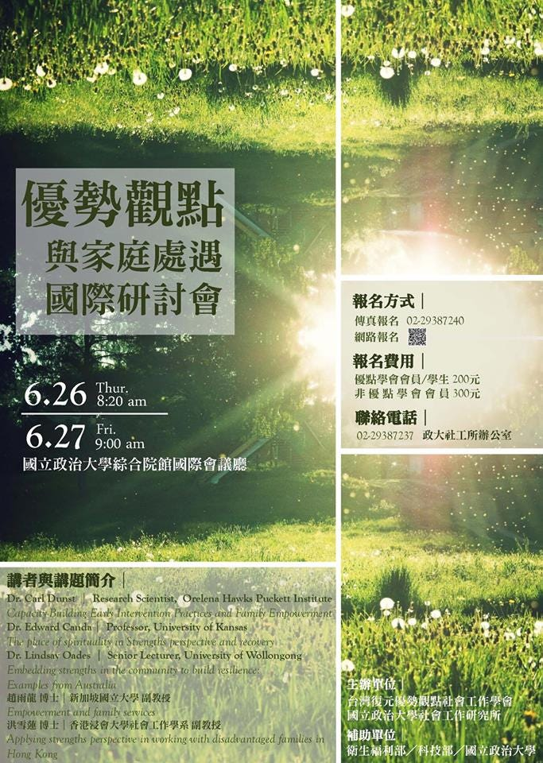

2012/11/02 『發現力量與優勢』 — 身心障礙領域運用優勢觀點研討會報名資訊

* 於101年11月2日將舉辦「『發現力量與優勢』 — 身心障礙領域運用優勢觀點研討會，報名簡章如附件，誠摯邀請對優勢觀點及身心障礙領域有興趣的社工實務夥伴及社工相關系所學生踴躍參與。
* 主辦單位：財團法人心路社會福利基金會 /協辦單位：社團法人台灣復元優勢觀點社會工作學會
* 報名方式：因名額有限(名額：100人)，依報名順序至額滿為止。請使用網路報名：<https://tinyurl.com/psnaf002> 。
* 報名時的email請務必填寫正確，待收到線上通知報名成功後，將寄發email告知繳費，未收到繳費通知者，請勿繳費，謝謝您的合作。

2012/07/09 優勢觀點督導認證申請表更新

* 經第一屆第七次理監事會議修訂通過，優勢觀點督導認證申請資格及辦法更新如下：  
  （一）申請資格：需具備社會工作實務相關經驗五年以上且實際運用優勢觀點三年以上之條件。  
  （二）申請認證條件：  
   1、督導年資達兩年以上。  
   2、操作優勢觀點個案工作至少五個以上、或帶領以優勢觀點為基 礎之團體工作達兩年以上。  
  3、公開發表優勢觀點案例至少一次。  
  4、經理事或監事推薦之人選。  
  (前三項為必要條件，須至少符合一項)  
  （三）督導認證更新制度為每三年由優點督導檢附以下任一項證明，持續授予證書。  
  1、參與優勢觀點相關研討會。  
  2、撰寫或發表優勢觀點相關文章。  
  3、教授優勢觀點相關課程。  
  4、出版優勢觀點相關書籍。  
  （四） 符合以上資格者，請將申請表及相關證明文件寄至台北市文山區指南路二段64號(社工所) 台灣復元優勢觀點社會工作學會收。

2012/08/03 「幸福紫鶴 夢想起飛」優勢觀點實務工作研討會簡章及報名資訊

* 社團法人台灣復元優勢觀點社會工作學會、社團法人桃園縣拾穗關懷服務協會及映晟社會工作師事務所將於101年8月31日合作辦理「幸福紫鶴 夢想起飛」優勢觀點實務工作研討會，報名簡章如附件，誠摯邀請社工實務夥伴及社工相關系所學生踴躍參與。
* 報名方式：電子郵件報名，請來信：[swer.yc@gmail.com](mailto:swer.yc@gmail.com)，該信箱將回傳報名表，請線 上填寫後報名，活動前將寄發通知確認報名成功。

2012/07/09 優勢觀點督導認證審核通過名單

* 感謝各方踴躍申請，經第一屆第七次理監事會審核通過名單如下：  
  張憶純、張豪、邱于倪、黃美甄、羅敏甄、蔡宜恬、朱仙雅、徐筱茜，共8人。

2011/09/09 100年復元與優勢觀點研討會議程及報名資訊

* 社團法人台灣復元優勢觀點學會將於100年11月3、4日兩天，於港都高雄舉辦100年「復元與優勢觀點研討會」，詳細議程及報名表請參照附件，誠摯邀請各界學者與實務工作者前來參與。(即日起受理報名，至100年10月28日截止)。

2011/09/26 優勢觀點督導認證審核通過名單

* 感謝各方踴躍申請，經第一屆第四次理監事會審核通過名單如下：  
  宋麗玉、施教裕、許坋妃、葉玉如、葉玉傑、郭貴蘭、王孟愉、張孟勳、呂敏昌、林庚辛、林芯玫、陳宜珍、曾仁杰、曾月娥、侯友忠、紀香如、吳慧菁、王美几、王鈺菱、林冠馨。

2011/09/26 恭賀學會會員優良事蹟

* 狂賀學會會員 蔡佑襁高中100年公職社工師。

2011/07/18 恭賀學會會員優良事蹟

* 狂賀學會會員 張憶純高中100年中國大陸清華大學及北京大學社會系博士班。

2011/03/14 恭賀宋麗玉和施教裕老師撰寫之「優勢觀點 — 社會工作理論與實務」一書，入選為《中國社會工作教材精粹》

* 宋麗玉和施教裕兩位老師撰寫之「優勢觀點 — 社會工作理論與實務」一書已於2010年10月由大陸社會科學文獻出版社以簡體字出版。該出版社更將此書選為《中國社會工作教材精粹》之一。
* 入選的教材需具備三項條件之一：(1)作者大多是在相關教學研究領域有建樹的中青年學者，他們在教學第一線，有著深厚的理論累積和豐富的實踐經驗。他們吸收、借鑑國內外優秀的教學內容與方法，理論聯繫實際，在內容體例和結構安排上都有所創新。(2)遴選近些年來有良好市場表現的教材，修訂出版。(3)在市場是沒有此類出版物而現實教學研究中又是非常需要的(宋麗玉、施教裕，2010，p. 3，王思斌總序)。
* 「優勢觀點 — 社會工作理論與實務」為入選《中國社會工作教材精粹》三本著作之一，期盼藉由此書在大陸出版，有助於復元與優勢觀點在當地社會工作界的推介和落實。

2011/01/26 台灣復元優勢觀點社會工作學會第一屆第四次理監事會

* 台灣復元優勢觀點社會工作學會第一屆第四次理監事會

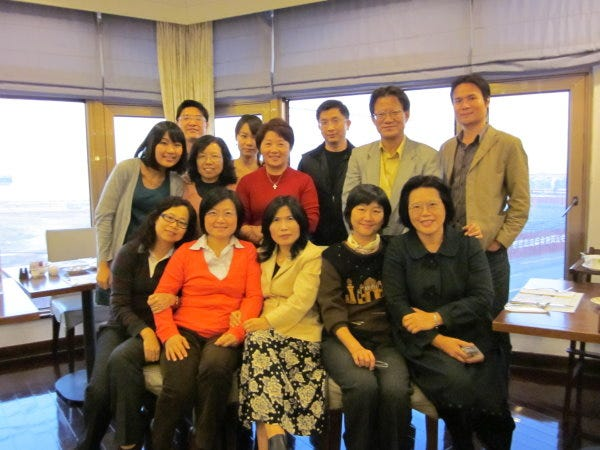

2011/01/26、2010/11/08 台灣復元優勢觀點社會工作學會中區小組會議

* 2010/11/08台灣復元優勢觀點社會工作學會中區小組會議

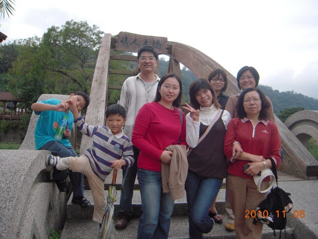
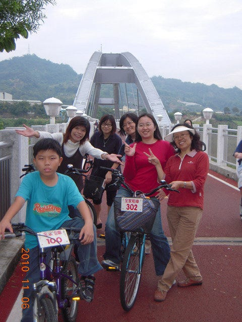

2010/11/20 優勢觀點督導認證開放申請囉,即日起至99年12月10日截止

* （一）為培養優勢觀點之督導人力，協助各機構落實優勢觀點，特建立認證制度，認證資格如下：  
  1、參與優勢觀點的實務年資達三年以上、且督導年資達兩年以上，前兩項之發生時間可重疊。  
  2、操作優勢觀點個案工作至少五個以上、或帶領以優勢觀點為基礎之團體工作達兩年以上。  
  3、公開發表優勢觀點案例至少一次。  
  4、經理事或監事推薦之人選。  
  (前三項為必要條件)
* （二）督導認證更新制度為每三年由優點督導檢附以下任一項證明，持續授予證書。  
  1、參與優勢觀點相關研討會。  
  2、撰寫或發表優勢觀點相關文章。  
  3、教授優勢觀點相關課程。  
  4、出版優勢觀點相關書籍。
* (三) 符合以上資格者，請將申請表及相關證明文件寄至台北市文山區指南路二段64號(社工所) 台灣復元優勢觀點社會工作學會收。

2010/09/30 恭賀學會會員優良事蹟

* 狂賀學會會員 胡孟菁、陳宜峰高中99年公職社工師。

2010/09/15 文章更新公告

* 文獻最新上傳新增中文期刊4篇、論文12篇、外文期刊73篇、外文書籍15篇，歡迎前往資訊分享區瀏覽檢索。歡迎各位學者與社工伙伴提供意見與建議，可至留言版留言或採用E-mail方式告知我們，謝謝！。

2010/03/18 恭賀學會師生優良事蹟

* 恭賀宋麗玉 教授榮獲行政院國家科學委員會98年傑出研究獎。
* 恭賀學會會員 廖偉迪、吳健瑋通過99年預官考試及格。
* 狂賀學會會員 林冠馨 高中98年北區三等公職社工師。

2010/01/27 優勢觀點─社會工作理論與實務 新書介紹

* 優勢觀點─社會工作理論與實務於2009年12月初版，由宋麗玉教授、施教裕教授共同編撰。此書是一本探索生命存在世界真相，並邁向無止境「改變」及「復元」旅程的指南，也是自助助人的手冊。
* 旨在論述美國實施近三十年之「優勢觀點社會工作」以及尊重案主主體性的「復元」觀點，強調人在情境的優點及正向經驗，運用「希望」和「想望」動力，看到人生目標和促進改變，在「理性」處遇取向之外，拓展「意義」與「靈性」之視域；並探討「人性」和「可能性」的根本議題，回歸真誠親善的人與人之關係，發現人生困境中的多元可能和替代抉擇。

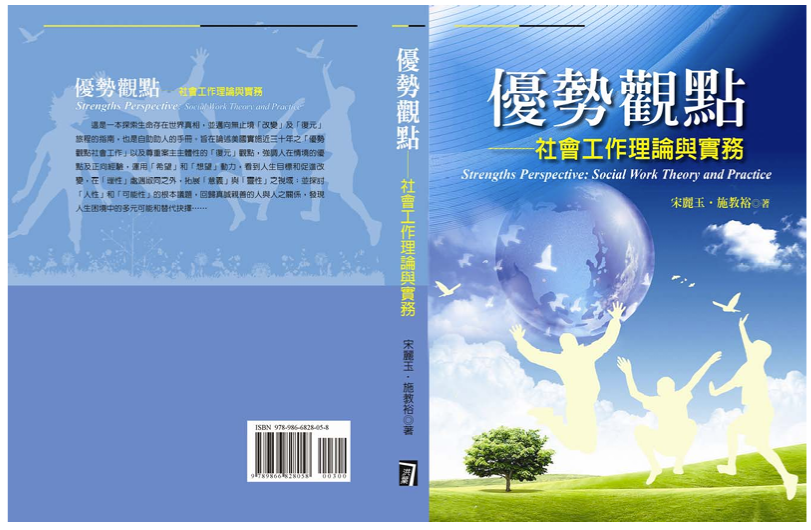

2010/01/27 文章更新公告

* 文獻最新上傳新增中文期刊10篇，外文期刊102篇，外文書籍15篇，歡迎前往資訊分享區瀏覽檢索。歡迎各位學者與社工伙伴提供意見與建議，可至留言版留言或採用E-mail方式告知我們，謝謝！

2009/10/15、10/16 復元與優勢觀點國際研討會圓滿落幕

* 「復元與優勢觀點國際研討會」於十月15、16日兩日舉行，本研討會除了邀請來自美國的Carolyn Tice教授和Kim Anderson教授，以及澳洲Dr. Lindsay Oades及香港葉錦成教授等四位教授演講外，也邀請來自不同縣市之社會工作實務及學術界的朋友發表論文，透過這次國際性研討會探討「優勢觀點個案管理模式」如何運用在社會工作實務上。
* 自六年前宋麗玉教授將復元與優勢觀點引進台灣以來，先後在婚暴、性侵害、高風險家庭、弱勢家庭兒少、精神疾病等領域推動，在許多政府與民間單位共同努力下，使得這個模式在理論概念的架構基礎、和工作操作原則的內涵方法，可以不斷開發和進步。兩日研討會的國內論文發表部份，也可以說是部份本土成功經驗的成果發表與分享。
* 黃碧霞社會司長認為優勢觀點在處遇理論的角色定位上，是可以與其他理論綜合融通的，在社會工作實務操作上，從優勢觀點評量到目標實踐，有具體的方法建構。尤其是歷年來在高風險家庭關懷方案的推動上，採用優勢觀點原則的社工員，都能締造良好的處遇結果。受暴婦女處遇之結果評估也顯示婦女憂鬱程度下降、自我權能增強、和生活滿意度略有提升，社工員也體驗到自身受益，大家不再是愁眉苦臉的無力感，而是快樂活潑的自信和希望！
* 吳思華校長在致詞時也特別代表政大師生向在八八水災中站在最前線的社工人員致上敬意，感謝社工人員在這段時間提供人性而有效的服務給受災的個人、家庭、社區，讓整個受創的社會可以儘速復元。
* 本研討會兩天共吸引了319人次參與，在社工所全體師生的投入之下，研討會順利圓滿落幕。

2009/07/20 文章更新公告

* 文獻最新上傳新增中文期刊1篇，外文期刊13篇，外文書籍5篇，歡迎前往資訊分享區瀏覽檢索。歡迎各位學者與社工伙伴提供意見與建議，可至留言版留言或採用E-mail方式告知我們，謝謝！

2009/07/05 復元與優勢觀點社會工作學會會費與入會費繳交事宜

* 復元與優勢觀點社會工作學會已獲得立案和成立法人，有關於會費與入會費的相關事宜再與各位會員說明一次:
* 入會費：  
  個人會員新台幣五百元（個人會員身份為學生收費兩百元）  
  團體會員新台幣壹仟元
* 常年會費  
  個人會員新台幣五百元（個人會員身份為學生收費兩百元）  
  團體會員新台幣壹仟元
* 戶名：社團法人台灣復元優勢觀點社會工作學會  
  劃撥帳號：50116552
* 勞請會員們於下次區域小組會議時，繳交給小組組長，屆時由小組組長保管年費500元作為區域聚會活動經費，入會費的部份以劃撥方式劃撥至上述的帳號。謝謝！另外，也勞請小組組長將繳交入會費以及常年會費的夥伴名單mail至 [98264001@nccu.edu.tw](mailto:98264001@nccu.edu.tw) ，學會助理將以郵寄方式寄發收據。先前已經繳交會費用的夥伴，敬請等待學會助理的收據，非常感謝大家的協助。

2009/06/13 復元與優勢觀點國際研討會詳細議程

* 國立政治大學社會工作研究所將於98年10月15日舉辦復元與優勢觀點國際研討會，詳細議程請見附件，誠摯邀請各界學者與實務工作者前來參與。

2009/05/21 復元優勢觀點社會工作學會成立照片

* 台灣復元優勢觀點社會工作學會成立照片已上傳至學會相簿，若各位會員願意分享成立大會的照片，歡迎將照片寄到學會信箱，謝謝。

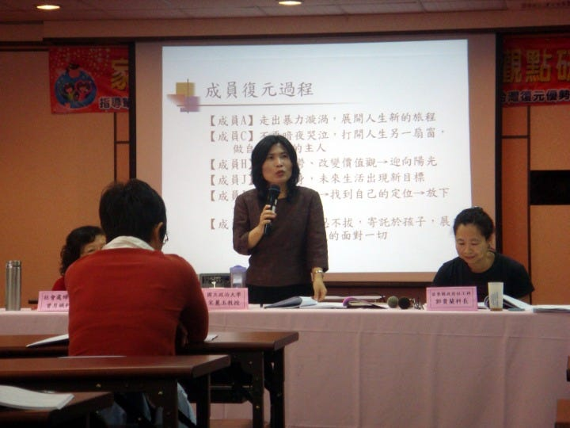

2009/04/15 復元優勢觀點社會工作學會成立公告

* 台灣復元優勢觀點社會工作學會於98年4月11日正式成立， 本會為依法設立、非以營利為目的之社會團體，以研究發展及倡導推動優勢觀點社會工作之學術理論與實務模式為宗旨，目前學會成員共61人。

2009/03/09 復元與優勢觀點社會工作學會成立大會詳細議程

* 復元與優勢觀點社會工作學會成立大會與彰化生命線協會之個案研討會合併辦理 — 98年家庭暴力及性侵害防治推動優勢觀點研討會 ，詳細議程請見附件，歡迎各位學者與夥伴踴躍參與。

2009/02/27 案例分享新增、文章更新公告

* 案例分享新增文章：走出生命的「ㄧㄡ」谷，歡迎踴躍前往觀賞。歡迎各位學者與社工伙伴提供意見與建議，可至留言版留言或採用E-mail方式告知我們，謝謝！
* 文獻最新上傳新增中文期刊6篇，外文期刊7篇，外文書籍29篇，歡迎前往資訊分享區瀏覽檢索。

2008/02/15 復元與優勢觀點社會工作學會成立大會相關事宜

* 復元與優勢觀點社會工作學會將於4/11日正式於彰化縣全台飯店正式成立，該成立大會與彰化生命線之個案研討會合併辦理，詳細議程將於三月中公佈。

2008/08/08 遷站公告

* 宋麗玉老師已於今年八月一日轉往政治大學社會工作研究所擔任專任教授，本網站將維持現狀繼續提供資料查詢；宋老師日後將於政治大學建構新的網站：復元與優勢觀點發展中心，更新資料將放置於新的網站中，敬請期待，亦請告知舊雨新知。

2008/01/03 文章更新公告

* 新增外文期刊19篇、中文期刊11篇、中文學位論文與書籍14篇、外文書籍9篇。歡迎前往【資訊分享區】檢索。

2007/12/11 優點復元處遇博碩士論文及實務工作報告徵文活動

* 96年『優點復元處遇博碩士論文及實務工作報告徵文』活動已成功結束，感謝各位社工伙伴、學者、研究生的踴躍投稿，本年度徵文活動共有一位參選者入選成功，請大家前往「國內資訊－研究成果」查看。
* 明年度預計於同時期舉辦徵文活動，請各位社會工作相關伙伴屆時密切注意本網頁之公告。

2007/09/20 案例分享新增、文章更新公告

* 案例分享新增兩部部影片：碧海有情、虎虎生風，歡迎踴躍前往觀賞。歡迎各位學者與社工伙伴提供意見與建議，可至留言版留言或採用E-mail方式告知我們，謝謝！
* 文獻最新上傳新增中文期刊11篇，中文書籍15篇，外文書籍7篇，歡迎前往資訊分享區瀏覽檢索。

2007/09/01 優點復元處遇博碩士論文及實務工作報告徵文活動公告

* 誠摯邀請國內外社會工作相關學門博碩士研究生、社會工作實務領域工作人員發表優點復元處遇模式相關研究論文、實務工作經驗工作報告。
* 本徵文活動自96年開始接受投稿，投稿期間為每年的9/15~9/30，入選者經學者專家審查擇優錄取可獲獎金，並登載於本網站。申請與審查程序預訂於96年7月公佈。

2007/05/06 文章更新、優點個案管理模式初階訓練課程公告

* 新增外文期刊8篇、中文期刊13篇、中文學位論文與書籍20篇、外文書籍6篇。歡迎各位前往資訊分享區檢索。
* 「優點個案管理模式初階訓練課程」於95/8/10、11日假高雄市苓雅青少年福利服務中心舉辦，歡迎踴躍參加。