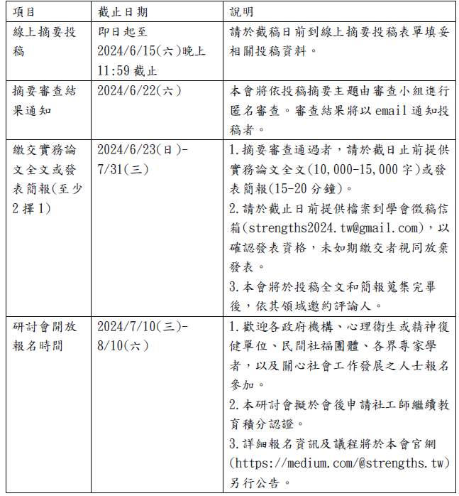
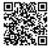
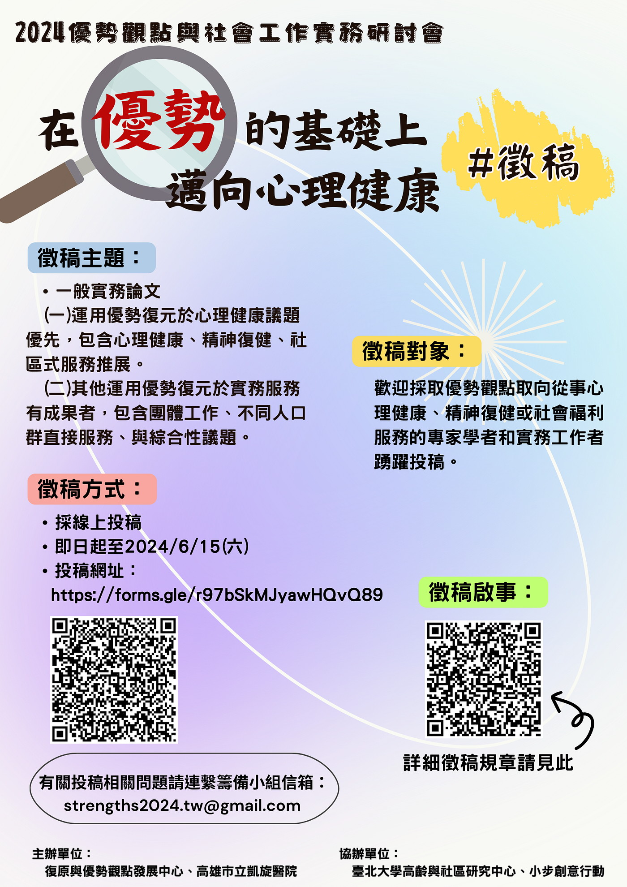

# 2024優勢觀點與社會工作實務研討會徵稿啟事

發布日期：2024-03-12  
分類：活動與研討會

<!-- ARTICLE CONTENT -->

## 主題：在優勢的基礎上邁向心理健康

1. 前言  
    本次研討會主題為「在優勢的基礎上邁向心理健康」，**議題聚焦為優勢觀點如何運用在心理健康實務及其優勢成效的展現**，期待透過學者專家、實務工作者，以及相關從業人員的相互交流與對話，發揮優勢觀點的精神和理念，提昇全民的心理健康與生活品質。為了促進以優勢為基礎的心理健康議題有更多的對話與交流，**本次研討會特地規劃台灣與香港各一場以精神復健為主題的論壇(panel)**，讓參與者有機會對照與認識台港兩地的精神復健發展脈絡，以及服務模式。除此之外，**與優勢相關的各人口群心理健康及社會福利議題亦是本次所關注的範疇**，期待透過跨專業和團隊的交流和對話，讓更多相關專業人員及實務工作者未來成為優勢的好夥伴。
2. 辦理單位  
   主辦單位：台灣復元優勢觀點社會工作學會、高雄凱旋醫院  
   協辦單位：台北大學高齡與社區研究中心、小步創意行動
3. 會議日期：2024年8月23日(五)
4. 會議地點：高雄市苓雅區凱旋二路130號凱旋醫院3樓凱旋廳
5. 徵稿主題  
   本次研討會歡迎各界投稿與優勢觀點相關的實務文章，徵稿範圍包括：  
   一、**一般實務論文：**  
   `(一)運用優勢復元於心理健康議題優先，包含心理健康、精神復健、社區式服務推展。  
   (二)其他運用優勢復元於實務服務有成果者，包含團體工作、不同人口群直接服務、與綜合性議題。`  
   二、**自組論壇（採邀請制)**：  
   `學會籌備小組主動邀請二位專家學者擔任各一場論壇召集人，論壇主題設定為優勢觀點與精神復健，由召集人自行邀請3至4位專家學者或實務工作組隊投稿。`
6. 徵稿對象  
   歡迎採取優勢觀點取向從事心理健康、精神復健或社會福利服務的專家學者和實務工作者踴躍投稿。
7. 投稿須知與應備文件  
   一、投稿資料  
   (一)一般實務論文：請投稿者於線上投稿表單提供發表稿件名稱、發表人資料，以及500字以內的稿件摘要。  
   (二)自組論壇(panel)：採學會邀請制。請論壇召集人於線上投稿表單提供論壇名稱、主持人、發表人、與談人等資料，以及500字以內的稿件摘要。  
   二、研討會重要時程項目

***線上摘要投稿*** *本次研討會採線上投稿，網址*

<https://forms.gle/r97bSkMJyawHQvQ89>

聯絡方式  
有關投稿相關問題請連繫籌備小組信箱：strengths2024.tw@gmail.com  
學會官方網站: [https://medium.com/@strengths.tw](../index.html)

