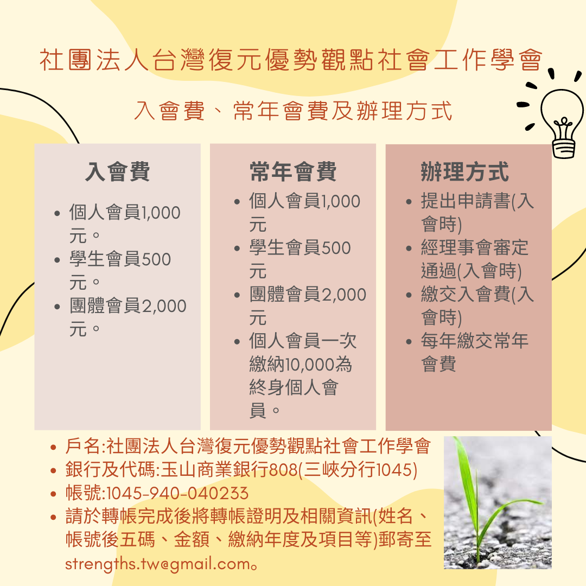

# 邀請您加入臺灣復元優勢觀點社會工作學會

發布日期：2024-03-23  
分類：學會介紹

<!-- ARTICLE CONTENT -->

只要對優勢觀點有興趣者，則可申入個人會員或團體會員。

本辦法係根據「臺灣復元優勢觀點社會工作學會」之組織章程規定所訂定。本辦法如有增訂修改，須經由「理監事會」通過始生效力，入會辦法如下 :

1. 入會費個人會員新台幣1000元(個人會員身分為學生新台幣500元)，團體會員2000元，於入會時繳納。
2. 常年會費個人人會員新台幣1000元(個人會員身分為學生新台幣500元)，團體會員2000元，個人會員一次繳納10000元為終身個人會員。
3. 申請加入「復元與優勢觀點學會」為會員者，須經「理監事會」通過其入會申請案，方具會員資格。  
   填妥表格後，請將表格e-mail至strengths.tw@gmail.com ，靜待「理監事會」的審核與通知，謝謝。

[申請表格請點選此處下載](../assets/attachments/da1b1df4cf845d18.docx)

