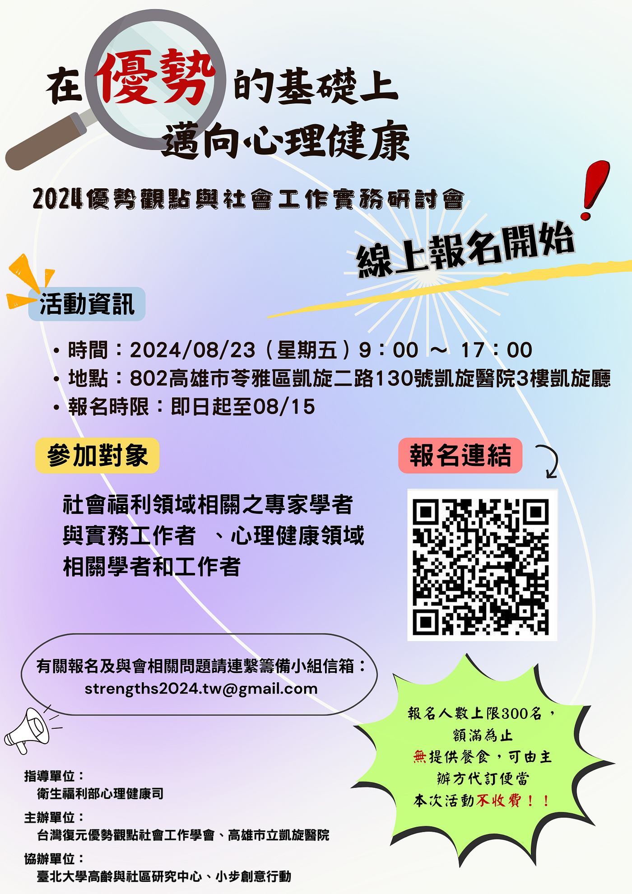
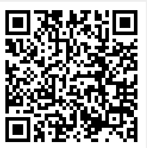

# 2024優勢觀點與社會工作研討會開始報名囉

發布日期：2024-07-02  
分類：活動與研討會

<!-- ARTICLE CONTENT -->

## 主題：在優勢的基礎上邁向心理健康

一、目的

本次研討會主題為**「在優勢的基礎上邁向心理健康」**，議題聚焦為優勢觀點如何運用在心理健康實務及其優勢成效的展現，期待透過學者專家、實務工作者，以及相關從業人員的相互交流與對話，發揮優勢觀點的精神和理念，提昇全民的心理健康與生活品質。世界衛生組織(WHO)將心理健康定義為「一個人可以實現其能力、可以應付日常生活中的壓力、工作有所成效、可以為其所有所貢獻的健康幸福狀態。」，換言之，心理健康不僅是沒有心理問題或精神疾病，更指涉個人內在是否具有權能感以追求自我實現，甚或是自我超越，而這正也是優勢觀點最終極的關懷與持續追求的目標。

2021年起台灣強化社會安全網2.0宣示「找出需要幫助的人」，將精神衛生服務與社區支持列為重點工作目標之一，顯示心理健康與精神復健議題之於當代社會人民的迫切性和重要性，也意味著相關專業人員和社會福利工作者將肩負起更沈重的責任和工作，無論是理論知識的擴展和驗證，或是跨專業合作的創新服務模式之發展，都需要專業與實務工作者共同努力，積極迎接挑戰。有別於現今醫療和疾病模式的精神復健主流，優勢觀點採取預防和積極的態度關注個人及家庭的全部面向，將焦點置於服務對象的優勢和資源，而非其障礙、疾病或問題，提供心理健康、精神復健及社會工作領域一個全新的視角，以及一個新的可能，讓服務使用者得以追求復元的圓滿人生。

為了促進以優勢為基礎的心理健康議題有更多的對話與交流，本次研討會特地規劃台灣與香港各一場以精神復健為主題的論壇(panel)，讓參與者有機會對照與認識台港兩地的精神復健發展脈絡，以及服務模式。除此之外，與優勢相關的各人口群心理健康及社會福利議題亦是本次所關注的範疇，期待透過跨專業和團隊的交流和對話，讓更多相關專業人員及實務工作者未來成為優勢的好夥伴。

二、主辦單位：台灣復元優勢觀點社會工作學會、高雄市立凱旋醫院

三、指導單位：衛生福利部心理健康司

四、協辦單位：台北大學社枓院高齡與社區研究中心、小步創意行動工作室

五、時間：2024年8月23日(五) 9:00–17:00

六、地點：802高雄市苓雅區凱旋二路130號凱旋醫院3樓凱旋廳

七、參加對象：社會福利領域相關之專家學者與實務工作者、心理健康領域相關學者和工作者

八、內容與議程

本次研討會以在優勢的基礎上邁向心理健康為主軸，廣邀國內外心理健康，以及社會福利領域學者專家和實務工作者進行相關專題演講與文章發表。

議程請見：<https://reurl.cc/z12y1N>

線上報名網址： <https://forms.gle/x5zr4woz449emhwi7>

113優勢研討會報名QRCode